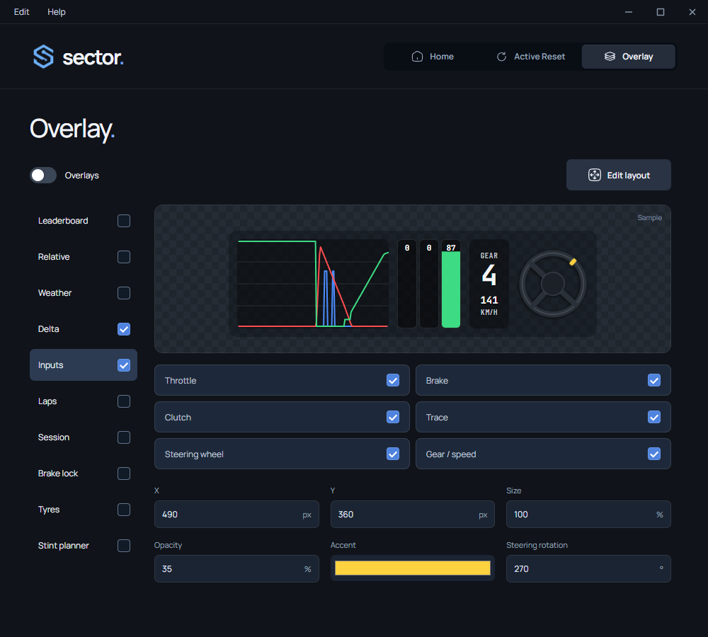

  

<h1 align="center">Sector</h1>

  
  &nbsp;&nbsp;&nbsp;
  
  &nbsp;&nbsp;&nbsp;
  
  &nbsp;&nbsp;&nbsp;
  

**Practice your driving and keep useful race information in view.**

Sector is a Windows app for **Le Mans Ultimate**. Save a point on track and return
to it to practice a corner or section again. Add customizable widgets over the
game to see standings, lap times, pedal inputs and more.

## 📥 Install Sector

You need **Windows 64-bit** and an installed copy of **Le Mans Ultimate**.

1. Open the [Releases page](https://github.com/sector-lmu/Sector/releases) and look
   for a Windows download named `Sector-<version>-win-x64.zip` under **Assets**.
2. Download the ZIP, right-click it in Windows and choose **Extract All**.
3. Open the extracted folder and double-click **`Sector.exe`**.

Sector runs directly from its folder: there is no installer and no additional
software to install. Keep the entire folder together; you can create a shortcut
to `Sector.exe` on your desktop.

If a release has no Windows ZIP attached, a ready-to-use package is not available
there yet. GitHub's **Source code** downloads contain project files, not the
ready-to-use app.

## 🚦 First launch

Sector looks for your LMU installation automatically. Confirm the folder it finds,
or use the folder picker to select it yourself. The correct folder contains
`Le Mans Ultimate.exe`.

If you do not know where LMU is installed, find it in your Steam Library, open
its **Manage → Browse local files** option and use that folder in Sector.

You can then choose a short guided tour. Open it again at any time through
**Help → Guide** in Sector's top menu.

**Active Reset requires LMU's Offline mode.** Select **Offline** in the game,
then start a **Practice** session. LMU must also be launched without
**Easy Anti-Cheat (EAC)**.

## 🏁 Active Reset

Active Reset lets you repeat the same part of a track without driving a full lap
back to it. A **checkpoint** is a saved point that includes your car's position,
direction and driving state at that moment.

1. Start LMU **without Easy Anti-Cheat (EAC)** and select **Offline** mode.
2. Load a **Practice** session, enter **DRIVE** and wait for Sector to connect.
3. Return to the game. At the point you want to practice from, press **F6** to save.
4. Keep driving, then press **F7** to return to that checkpoint.

The car returns with the saved driving state, including its saved speed. Saving
again replaces the checkpoint, so you can choose a new section to practice.
If Sector reports that the checkpoint is no longer available, save a new one.

### Change the keys and sounds

Open **Active Reset**, click the key you want to change and press its replacement
on your keyboard. Choose keys that are not already assigned to an action in LMU.
Release both keys before using them in the game.

Confirmation sounds tell you when a save or restore succeeds, or when a request
is rejected. You can preview or mute them on the same page.

## 📊 Overlay

Overlays are small widgets displayed over the game. Choose the information you
want to keep in view:

*Widget previews use demo data.*

| Widget | What it shows |
| --- | --- |
| **Leaderboard** | Standings and car classes |
| **Relative** | Nearby cars and estimated gaps |
| **Weather** | Available weather information |
| **Delta** | How your current lap compares with the reference lap |
| **Inputs** | Pedals, steering, gear and speed |
| **Laps** | Lap history and available usage information |
| **Session** | Session and player information |

### Widgets in motion

Watch the pedals, steering, gears and lap delta update in this demo.

### Make it your own

Open **Overlay**, enable the widgets you want and turn on **Overlays**.
Use **Edit layout** to move and resize them, then select **Lock layout** when
finished. Once locked, mouse clicks pass through to the game.

Each widget has its own options. You can change size and transparency, hide
columns or logos, and remove elements such as the clutch input. To choose a
monitor, open **Edit → Settings → Overlay**.

View app settings

Run LMU in **windowed or borderless mode**. The live widgets appear when you are
in a session with the game in the foreground. The editor can show sample data
while you arrange your layout; unavailable live values appear as a dash.

## Keep Sector running in the background

Closing the window gives you three choices:

- **Run in background** keeps Sector and its shortcuts running while hiding the window.
- **Quit Sector** closes the app and stops its features.
- **Cancel** returns to the window.

To reopen Sector, use its icon in the Windows notification area beside the clock,
or launch `Sector.exe` again.

## Need help?

See the [user guide](docs/README.md) for setup help, common problems and updating
Sector. You can also open **Help → Guide** inside the app.

## Support Sector

If Sector is useful to you, give the repository a star. You can also support
its development with a **[voluntary donation on Ko-fi](https://ko-fi.com/illandiii)**.

Sector is an independent project and is not affiliated with Le Mans Ultimate.
Its original code and documentation use the [MIT license](LICENSE); third-party
assets retain their [own terms and attribution](src/ui/electron/THIRD_PARTY_NOTICES.md).

Interested in contributing? See the [developer guide](CONTRIBUTING.md).
